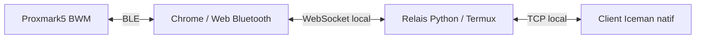

# PM5 Control

**Interface Web Bluetooth indépendante pour Proxmark5 et le client natif Iceman sous Android.**

[English](README.md) | **Français**

## Pourquoi j'ai créé ce projet

Je souhaitais utiliser mon Proxmark5 depuis mon téléphone Android sans devoir emporter un ordinateur. Mon téléphone étant administré, je ne peux pas installer moi-même de nouvelles applications. Chrome et Termux étaient déjà disponibles. Je me suis donc posé une question : serait-il possible de confier la communication BLE au navigateur tout en conservant le véritable client Iceman dans Termux ?

PM5 Control est né de cette expérimentation. Il propose une approche complémentaire dans les environnements où Chrome, Termux, le Bluetooth et les scripts locaux sont explicitement autorisés, mais où le déploiement d'un APK dédié est difficile. Il ne modifie pas les politiques d'administration du téléphone et n'accorde aucun privilège Android supplémentaire.

## Architecture

Le navigateur assure le transport BLE et l'interface, tandis que Python relaie les données vers le client Iceman natif. Le projet ne remplace ni la pile RFID d'Iceman ni Proxmark Studio.

## Fonctionnalités du prototype

- Aucun APK dédié supplémentaire ni root dans la configuration testée.
- Communication BLE locale et terminal Iceman natif.
- Identification du firmware et compilation du client correspondant.
- Lectures RFID et diagnostics matériels adaptés au mobile.
- Surveillance de la batterie : charge, tension, courant, capacité, autonomie et temps de recharge estimés.
- Démarrage à la demande, déconnexion et arrêt après inactivité.

Chrome, Termux, les dépendances locales et un firmware compatible restent nécessaires. Leur utilisation doit être autorisée.

## Validation initiale

| Composant | Configuration testée |
| --- | --- |
| Téléphone | Samsung Galaxy A35 5G (SM-A356B) |
| Android | 16 |
| Navigateur | Chrome |
| Termux | Google Play 2026.10.09 |
| Matériel | Proxmark5 avec BWM |
| Révision Iceman | `754bbae3d` |

Les premiers essais physiques ont démontré la communication BLE, l'identification du firmware, le démarrage du client correspondant, les diagnostics matériels, les mesures d'antenne et la lecture ciblée ISO14443-A. Des erreurs de réception intermittentes ont été observées lors de certaines recherches RFID. La stabilité sur la durée, les estimations de recharge et la compatibilité avec d'autres matériels restent à valider.

## État du projet

Prototype expérimental, non destiné à la production. Le code sera publié après vérification de sa sécurité, de sa provenance et de sa licence. Aucun paquet d'installation n'est actuellement publié ici.

Consulter la [feuille de route](ROADMAP.fr.md) et les [notes de sécurité](SECURITY.fr.md). Les retours et contributions techniques sont les bienvenus.

## Remerciements

Je tiens avant tout à remercier sincèrement Iceman, RFID Research Group et toutes les personnes qui contribuent depuis des années à l'écosystème Proxmark.

Un remerciement particulier aux développeurs et premiers contributeurs de Proxmark Studio, ainsi qu'à la communauté Termux. Leur travail, leur documentation et les connaissances partagées ont rendu cette expérimentation possible.

Mon intention est simplement d'apporter ma contribution, à mon niveau, en explorant une manière complémentaire d'utiliser ces excellents outils sur Android.

- [Iceman / Proxmark3](https://github.com/RfidResearchGroup/proxmark3)
- [Proxmark Studio](https://github.com/RfidResearchGroup/ProxmarkStudio)
- [Termux](https://github.com/termux/termux-app)

## Utilisation responsable et licence

Ce projet indépendant n'est ni affilié ni approuvé officiellement par RFID Research Group. Utilisation uniquement dans des environnements explicitement autorisés, dans le respect des politiques d'administration et de la législation applicable. La licence du code sera précisée après vérification des obligations liées aux projets en amont.

Mainteneur : [limerx](https://github.com/limerx)
