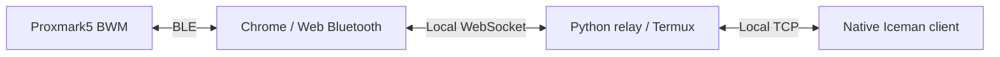

# PM5 Control

**An independent Web Bluetooth interface for Proxmark5 and the native Iceman client on Android.**

**English** | [Français](README.fr.md)

## Why I created this project

I wanted to use my Proxmark5 from my Android phone without carrying a computer. My phone is centrally managed, so I cannot install additional Android applications myself. Chrome and Termux were already available. This led me to explore a simple question: could a browser provide the BLE transport while the real Iceman client runs locally in Termux?

PM5 Control grew out of this experiment. It is a complementary approach for environments where Chrome, Termux, Bluetooth and local scripts are explicitly permitted, but deploying another dedicated APK is impractical. It neither modifies device management policies nor grants additional Android privileges.

## Architecture

The browser handles BLE and the user interface. Python relays data locally to the native client. This project does not replace the Iceman RFID stack or Proxmark Studio.

## Prototype capabilities

- No dedicated additional APK or root required in the tested configuration.
- Local BLE communication and native Iceman terminal.
- Firmware identification and firmware-matched client compilation.
- Mobile-oriented RFID reading and hardware diagnostics.
- Battery state of charge, voltage, current, capacity, estimated runtime and charging time.
- On-demand execution, explicit disconnection and inactivity-based shutdown.

Existing authorized Chrome and Termux installations, local dependencies and compatible firmware are prerequisites.

## Initial hardware validation

| Component | Tested configuration |
| --- | --- |
| Phone | Samsung Galaxy A35 5G (SM-A356B) |
| Android | 16 |
| Browser | Chrome |
| Termux | Google Play 2026.10.09 |
| Hardware | Proxmark5 with BWM |
| Iceman revision | `754bbae3d` |

Initial physical tests demonstrated BLE communication, firmware identification, firmware-matched client startup, hardware status, antenna measurements and targeted ISO14443-A reading. Some broad RFID searches produced intermittent reception errors. Long-running stability, charging estimates and wider compatibility remain to be validated.

## Project status

Experimental prototype, not a production-ready release. Source distribution is planned after security, provenance and licensing review. No installation package is published here yet.

See the [roadmap](ROADMAP.md) and [security notes](SECURITY.md). Feedback and technical contributions are welcome.

## Acknowledgements

First and foremost, I would like to sincerely thank Iceman, RFID Research Group and everyone who has contributed to the Proxmark ecosystem over the years.

Special thanks to the developers and early contributors of Proxmark Studio, and to the Termux community. Their work, documentation and shared knowledge made this experiment possible.

My intention is simply to contribute, at my own level, by exploring a complementary way to use these excellent tools on Android.

- [Iceman / Proxmark3](https://github.com/RfidResearchGroup/proxmark3)
- [Proxmark Studio](https://github.com/RfidResearchGroup/ProxmarkStudio)
- [Termux](https://github.com/termux/termux-app)

## Responsible use and licensing

This independent project is not affiliated with or endorsed by RFID Research Group. Use only in explicitly authorized environments and respect organizational device policies and applicable law. The source license will be specified after review of upstream obligations.

Maintainer: [limerx](https://github.com/limerx)
